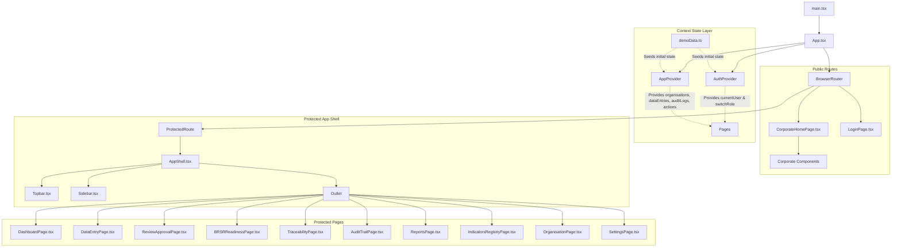
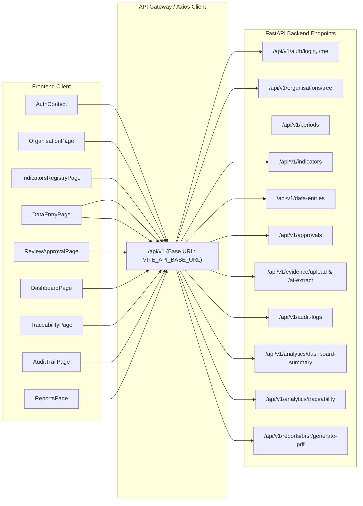

# SustainX / MEIL ESG Portal — Architecture, File Connections & Backend Integration Guide

> **Application:** Megha Engineering & Infrastructures Limited (MEIL) — Corporate ESG Reporting & BRSR Assurance Portal  
> **Framework:** React 18, Vite, TypeScript, Tailwind CSS, React Router v7  
> **Status:** Phase 1 Frontend Complete (Mock State & Pre-seeded Indicators) $\rightarrow$ Phase 2 Backend Ready

---

## 1. Executive Summary & File Tree Overview

The SustainX repository contains the complete frontend architecture for MEIL's SEBI BRSR (Business Responsibility and Sustainability Reporting) Corporate Portal.

```
SustainX/
├── README.md                                # Project specification & roadmap
├── ARCHITECTURE_AND_INTEGRATION_GUIDE.md   # This comprehensive architectural reference
└── frontend/
    ├── package.json                         # Dependencies (React 19/18, React Router v7, Recharts, Lucide)
    ├── vite.config.ts / tsconfig.json       # Build configuration
    ├── index.html                           # Root HTML mount point (#root)
    └── src/
        ├── main.tsx                         # React root bootstrap
        ├── App.tsx                          # Router tree, route guards, context providers
        ├── index.css                        # Tailwind imports & MEIL corporate theme rules
        ├── types/
        │   └── index.ts                     # TypeScript data models, enums & interfaces
        ├── contexts/
        │   ├── AuthContext.tsx              # RBAC state & persona switcher
        │   └── AppContext.tsx               # Central application state & action dispatchers
        ├── data/
        │   └── demoData.ts                  # Mock database, 22 BRSR indicators & seed entities
        ├── components/
        │   ├── common/                      # Reusable application shell & UI atoms
        │   │   ├── AppShell.tsx             # Persistent layout (Topbar + Sidebar + Breadcrumbs + Outlet)
        │   │   ├── Topbar.tsx               # Header branding, entity selector, role switcher & alerts
        │   │   ├── Sidebar.tsx              # Role-aware collapsible navigation drawer
        │   │   ├── KpiCard.tsx              # Metric display card
        │   │   ├── ProgressBar.tsx          # Progress indicators
        │   │   └── StatusBadge.tsx          # Workflow status badges (DRAFT, SUBMITTED, APPROVED)
        │   └── corporate/                   # Public-facing MEIL corporate website replica
        │       ├── CorporateTopUtilityBar.tsx
        │       ├── CorporateHeader.tsx
        │       ├── CorporateSecondaryNavStrip.tsx
        │       ├── CorporateHeroBanner.tsx
        │       ├── CorporateContentSection.tsx
        │       └── CorporateFooter.tsx
        └── pages/                           # Application route views
            ├── CorporateHomePage.tsx        # Public website ('/' & '/corporate')
            ├── LoginPage.tsx                # Authentication & 1-click persona testing ('/login')
            ├── DashboardPage.tsx            # Executive KPI & decarbonization charts ('/dashboard')
            ├── DataEntryPage.tsx            # BRSR Section A/B/C metric collection ('/data-entry')
            ├── ReviewApprovalPage.tsx       # ESG Officer approval workflow ('/review')
            ├── BRSRReadinessPage.tsx        # Statutory readiness scorecard ('/brsr-readiness')
            ├── TraceabilityPage.tsx         # Source-to-report audit decomposition ('/traceability')
            ├── AuditTrailPage.tsx           # Immutable change log ('/audit-trail')
            ├── ReportsPage.tsx              # BRSR Annexure I PDF/Excel generator ('/reports')
            ├── IndicatorsRegistryPage.tsx   # Indicator metadata master registry ('/indicators')
            ├── OrganisationPage.tsx         # Conglomerate hierarchy tree ('/organisation')
            └── SettingsPage.tsx             # Reporting cycles & security policies ('/settings')
```

---

## 2. Component & Data Flow Diagram



---

## 3. How the Files are Connected

### 3.1 Bootstrap & Routing Flow
1. **[main.tsx](file:///c:/Users/Biswaranjan%20Sahoo/.gemini/antigravity-ide/scratch/SustainX/frontend/src/main.tsx)**:
   - Renders `<App />` inside React strict mode and mounts it into the `#root` DOM node.
2. **[App.tsx](file:///c:/Users/Biswaranjan%20Sahoo/.gemini/antigravity-ide/scratch/SustainX/frontend/src/App.tsx)**:
   - Wraps the application in `<AuthProvider>` and `<AppProvider>`, ensuring all pages have access to authentication state and application data.
   - Declares the route tree using `react-router-dom`:
     - **Public:** `/`, `/corporate`, `/login`
     - **Protected:** `/dashboard`, `/data-entry`, `/review`, `/brsr-readiness`, `/traceability`, `/audit-trail`, `/reports`, `/indicators`, `/organisation`, `/settings`
   - All protected routes are wrapped in `<ProtectedRoute>` (which redirects unauthenticated sessions to `/login`) and rendered inside `<AppShell>`.

### 3.2 State Management Layer
1. **[AuthContext.tsx](file:///c:/Users/Biswaranjan%20Sahoo/.gemini/antigravity-ide/scratch/SustainX/frontend/src/contexts/AuthContext.tsx)**:
   - Manages `currentUser`, `currentRole`, `isAuthenticated`.
   - Persists session in browser `localStorage` under `meil_auth_user`.
   - Provides `switchRole(role)` allowing instantaneous testing between:
     - `GROUP_SUSTAINABILITY` (Amit Verma - CSO)
     - `SITE_USER` (Rahul Sharma - Site Engineer)
     - `ESG_OFFICER` (Priya Nair - Approver)
     - `AUDITOR` (Sarah Jenkins - Assurance)
     - `ADMIN` (Kiran Reddy - IT Admin)
2. **[AppContext.tsx](file:///c:/Users/Biswaranjan%20Sahoo/.gemini/antigravity-ide/scratch/SustainX/frontend/src/contexts/AppContext.tsx)**:
   - Central reactive store for all ESG reporting workflows.
   - Holds selected scope: `selectedOrgId`, `selectedOrg`, `selectedPeriodId`, `selectedPeriod`.
   - Holds mutable state arrays: `dataEntries`, `auditLogs`, `alerts`.
   - Exposes action dispatchers:
     - `updateDataEntry(indicatorId, value, unit, remarks)`: Updates or initializes a draft metric and automatically emits a `CREATE` or `UPDATE` audit log.
     - `submitDataEntry(entryId)`: Transitions status `DRAFT` $\rightarrow$ `SUBMITTED` and emits an audit event.
     - `approveDataEntry(entryId, comments)`: Transitions status `SUBMITTED` $\rightarrow$ `APPROVED` with approver stamp and logs it.
     - `rejectDataEntry(entryId, comments)`: Transitions status to `REJECTED` and triggers rework.
     - `addEvidence(entryId, fileData)`: Binds physical receipts/meter photos to a metric with SHA-256 hashes.

### 3.3 Layout & Shell Hierarchy
1. **[AppShell.tsx](file:///c:/Users/Biswaranjan%20Sahoo/.gemini/antigravity-ide/scratch/SustainX/frontend/src/components/common/AppShell.tsx)**:
   - Houses the sticky `Topbar`, collapsible `Sidebar`, dynamic breadcrumbs (`MEIL ESG / [Entity Name] / [Active Page]`), and the `<Outlet />` viewport.
2. **[Topbar.tsx](file:///c:/Users/Biswaranjan%20Sahoo/.gemini/antigravity-ide/scratch/SustainX/frontend/src/components/common/Topbar.tsx)**:
   - Connects to `AppContext` to render the entity selector dropdown (`selectedOrgId`) and financial period selector (`selectedPeriodId`).
   - Connects to `AuthContext` to provide the top right **Judge & Demo Persona Switcher** and Logout.
   - Provides a link back to the public Corporate portal.
3. **[Sidebar.tsx](file:///c:/Users/Biswaranjan%20Sahoo/.gemini/antigravity-ide/scratch/SustainX/frontend/src/components/common/Sidebar.tsx)**:
   - Reads `currentRole` from `AuthContext`.
   - Filters visible navigation items using Role-Based Access Control (`allowedRoles.includes(currentRole)`).
   - Shows real-time badge counters for pending items (e.g., pending review count).

### 3.4 Page Functions & Interdependencies
| Page File | Primary Purpose | Reads From | Modifies / Triggers |
| :--- | :--- | :--- | :--- |
| **[CorporateHomePage.tsx](file:///c:/Users/Biswaranjan%20Sahoo/.gemini/antigravity-ide/scratch/SustainX/frontend/src/pages/CorporateHomePage.tsx)** | High-fidelity MEIL corporate portal | Corporate components | Links to `/dashboard` & `/login` |
| **[LoginPage.tsx](file:///c:/Users/Biswaranjan%20Sahoo/.gemini/antigravity-ide/scratch/SustainX/frontend/src/pages/LoginPage.tsx)** | Authentication & 1-click role presets | `DEMO_USERS` | Calls `login()`, redirects to `/dashboard` |
| **[DashboardPage.tsx](file:///c:/Users/Biswaranjan%20Sahoo/.gemini/antigravity-ide/scratch/SustainX/frontend/src/pages/DashboardPage.tsx)** | Executive KPI dashboard & decarbonization trends | `AppContext.dashboardSummary`, `alerts` | Navigation to `/review`, `/data-entry`, etc. |
| **[DataEntryPage.tsx](file:///c:/Users/Biswaranjan%20Sahoo/.gemini/antigravity-ide/scratch/SustainX/frontend/src/pages/DataEntryPage.tsx)** | Site-level BRSR indicator input (P1–P9) | `INDICATORS`, `dataEntries`, `selectedOrg` | Calls `updateDataEntry()`, `submitDataEntry()`, `addEvidence()` |
| **[ReviewApprovalPage.tsx](file:///c:/Users/Biswaranjan%20Sahoo/.gemini/antigravity-ide/scratch/SustainX/frontend/src/pages/ReviewApprovalPage.tsx)** | ESG Officer verification queue | `dataEntries` where status is `SUBMITTED` | Calls `approveDataEntry()`, `rejectDataEntry()` |
| **[BRSRReadinessPage.tsx](file:///c:/Users/Biswaranjan%20Sahoo/.gemini/antigravity-ide/scratch/SustainX/frontend/src/pages/BRSRReadinessPage.tsx)** | SEBI statutory readiness audit scorecard | `dashboardSummary` readiness metrics | Triggers report export |
| **[TraceabilityPage.tsx](file:///c:/Users/Biswaranjan%20Sahoo/.gemini/antigravity-ide/scratch/SustainX/frontend/src/pages/TraceabilityPage.tsx)** | Group-to-site metric lineage decomposition | `DEMO_TRACEABILITY_GHG_TREE`, `DEMO_EVIDENCE` | Visual tree drill-down to site receipts & meter logs |
| **[AuditTrailPage.tsx](file:///c:/Users/Biswaranjan%20Sahoo/.gemini/antigravity-ide/scratch/SustainX/frontend/src/pages/AuditTrailPage.tsx)** | Immutable audit ledger & diff inspector | `AppContext.auditLogs` | Filter by action type, view before/after JSON diffs |
| **[ReportsPage.tsx](file:///c:/Users/Biswaranjan%20Sahoo/.gemini/antigravity-ide/scratch/SustainX/frontend/src/pages/ReportsPage.tsx)** | Statutory filing generation center | `INDICATORS`, `selectedOrg`, `selectedPeriod` | Generates SEBI Annexure I & Core Workbooks |
| **[OrganisationPage.tsx](file:///c:/Users/Biswaranjan%20Sahoo/.gemini/antigravity-ide/scratch/SustainX/frontend/src/pages/OrganisationPage.tsx)** | Group corporate structural hierarchy | `organisationTree` from `AppContext` | Calls `setSelectedOrgId()` to change active reporting scope |
| **[IndicatorsRegistryPage.tsx](file:///c:/Users/Biswaranjan%20Sahoo/.gemini/antigravity-ide/scratch/SustainX/frontend/src/pages/IndicatorsRegistryPage.tsx)** | Master catalog of statutory indicators | `INDICATORS` | Filter, search & view indicator validation logic |
| **[SettingsPage.tsx](file:///c:/Users/Biswaranjan%20Sahoo/.gemini/antigravity-ide/scratch/SustainX/frontend/src/pages/SettingsPage.tsx)** | Reporting cycles & platform configuration | `reportingPeriods` | Administrative inspection |

---

## 4. Where and How the Frontend Will Connect to the Backend

Currently, the frontend uses in-memory React state initialized with `demoData.ts`. In Phase 2, this will be connected to a real **FastAPI + PostgreSQL** backend.

Here is the exact blueprint of where every part of the frontend connects to real backend services:



### 4.1 Step 1: Create the API Client (`frontend/src/services/api.ts`)
To connect the frontend, create an Axios client with environment variables and JWT token injection:

```typescript
// frontend/src/services/api.ts
import axios from 'axios';

export const apiClient = axios.create({
  baseURL: import.meta.env.VITE_API_BASE_URL || 'http://localhost:8000/api/v1',
  headers: {
    'Content-Type': 'application/json',
  },
});

apiClient.interceptors.request.use((config) => {
  const token = localStorage.getItem('meil_auth_token');
  if (token) {
    config.headers.Authorization = `Bearer ${token}`;
  }
  return config;
});
```

### 4.2 Endpoint Mapping Table

| Frontend File / Hook | Current Mock Connection | Target REST Endpoint | HTTP Method | Payload / Response |
| :--- | :--- | :--- | :---: | :--- |
| **`AuthContext.login()`** | `DEMO_USERS` lookup | `/api/v1/auth/login` | `POST` | **Request:** `{ email, password }`<br/>**Response:** `{ token, user }` |
| **`AuthContext` initialization** | `localStorage` item | `/api/v1/auth/me` | `GET` | **Response:** User profile & active RBAC role |
| **`AppContext.organisations`** | `ORGANISATIONS` | `/api/v1/organisations` | `GET` | List of subsidiaries, BUs & projects |
| **`AppContext.organisationTree`** | `getOrganisationTree()` | `/api/v1/organisations/tree` | `GET` | Nested hierarchical organisation tree |
| **`AppContext.reportingPeriods`** | `REPORTING_PERIODS` | `/api/v1/periods` | `GET` | List of financial years & status |
| **`IndicatorsRegistryPage`** | `INDICATORS` | `/api/v1/indicators` | `GET` | 22+ BRSR indicator definitions & rules |
| **`DataEntryPage` (Load)** | `dataEntries` filter | `/api/v1/data-entries?org_id=&period_id=` | `GET` | List of project-level metric submissions |
| **`DataEntryPage.handleSaveDraft()`** | `updateDataEntry()` | `/api/v1/data-entries` | `POST` / `PUT` | **Request:** `{ org_id, indicator_id, period_id, value, unit, remarks }` |
| **`DataEntryPage.handleSubmitForReview()`** | `submitDataEntry()` | `/api/v1/data-entries/{id}/submit` | `POST` | Status transition to `SUBMITTED` |
| **`DataEntryPage.handleUploadEvidence()`** | `addEvidence()` | `/api/v1/evidence/upload` | `POST` (Multipart) | Uploads file to S3/MinIO, returns file path and SHA-256 hash |
| **`DataEntryPage` (Phase 3 OCR)** | *(New feature)* | `/api/v1/evidence/ai-extract` | `POST` | Bill OCR extraction $\rightarrow$ fills numeric value & unit |
| **`ReviewApprovalPage` (Queue)** | `dataEntries` filter | `/api/v1/approvals/pending` | `GET` | Returns list of pending submissions for review |
| **`ReviewApprovalPage.handleApprove()`** | `approveDataEntry()` | `/api/v1/approvals/{id}/approve` | `POST` | **Request:** `{ comments }`<br/>Triggers group rollup aggregation |
| **`ReviewApprovalPage.handleReject()`** | `rejectDataEntry()` | `/api/v1/approvals/{id}/reject` | `POST` | **Request:** `{ comments }`<br/>Returns to site user for edit |
| **`DashboardPage` (KPIs & Trends)** | `DEMO_DASHBOARD_SUMMARY` | `/api/v1/analytics/dashboard-summary?org_id=&period_id=` | `GET` | Consolidated ESG metrics, P6 GHG, P3/P5 social stats |
| **`TraceabilityPage`** | `DEMO_TRACEABILITY_GHG_TREE` | `/api/v1/analytics/traceability?metric=GHG&period_id=` | `GET` | Full lineage decomposition graph with audit node IDs |
| **`AuditTrailPage`** | `auditLogs` array | `/api/v1/audit-logs?period_id=` | `GET` | Chronological database audit log records |
| **`ReportsPage.handleDownload()`** | Browser toast trigger | `/api/v1/reports/brsr/annexure-1/pdf` | `GET` | Generates and streams SEBI Annexure I PDF |

---

## 5. Transitioning from Mock State to Live Backend

To switch any component from mock data to live API calls, update the functions in **[AppContext.tsx](file:///c:/Users/Biswaranjan%20Sahoo/.gemini/antigravity-ide/scratch/SustainX/frontend/src/contexts/AppContext.tsx)** using standard `useEffect` and asynchronous methods:

### Example: Connecting Data Entries to Live Backend
```typescript
// Replace mock update in AppContext.tsx:
const updateDataEntry = async (indicatorId: string, value: number, unit?: string, remarks?: string) => {
  try {
    const response = await apiClient.post('/data-entries', {
      organisationId: selectedOrgId,
      indicatorId,
      reportingPeriodId: selectedPeriodId,
      numericValue: value,
      unit,
      remarks,
    });
    
    // Update local state with the database record
    setDataEntries(prev => {
      const idx = prev.findIndex(e => e.id === response.data.id);
      if (idx >= 0) {
        const copy = [...prev];
        copy[idx] = response.data;
        return copy;
      }
      return [response.data, ...prev];
    });
  } catch (err) {
    console.error('Failed to persist data entry:', err);
  }
};
```

---

## 6. Summary Checklist for Full-Stack Integration

- [x] **Phase 1 (Completed):** Complete React frontend with MEIL Design System, 12 pages, RBAC switcher, and BRSR indicator schemas.
- [ ] **Phase 2 (Next):** Implement FastAPI backend in `backend/app/main.py` with SQLAlchemy models matching `types/index.ts`.
- [ ] **Phase 2:** Configure `VITE_API_BASE_URL` in `frontend/.env`.
- [ ] **Phase 2:** Swap `demoData.ts` in `AppContext` and `AuthContext` with Axios API calls.
- [ ] **Phase 3:** Implement OCR Bill Extractor endpoint (`/api/v1/evidence/ai-extract`) for the evidence dropzone.
- [ ] **Phase 4:** Build PDF generation service in Python using ReportLab / WeasyPrint for statutory filing downloads.
- [ ] **Phase 5:** Orchestrate multi-container deployment using `docker-compose.yml` (PostgreSQL 16 + FastAPI + Nginx Vite frontend).
