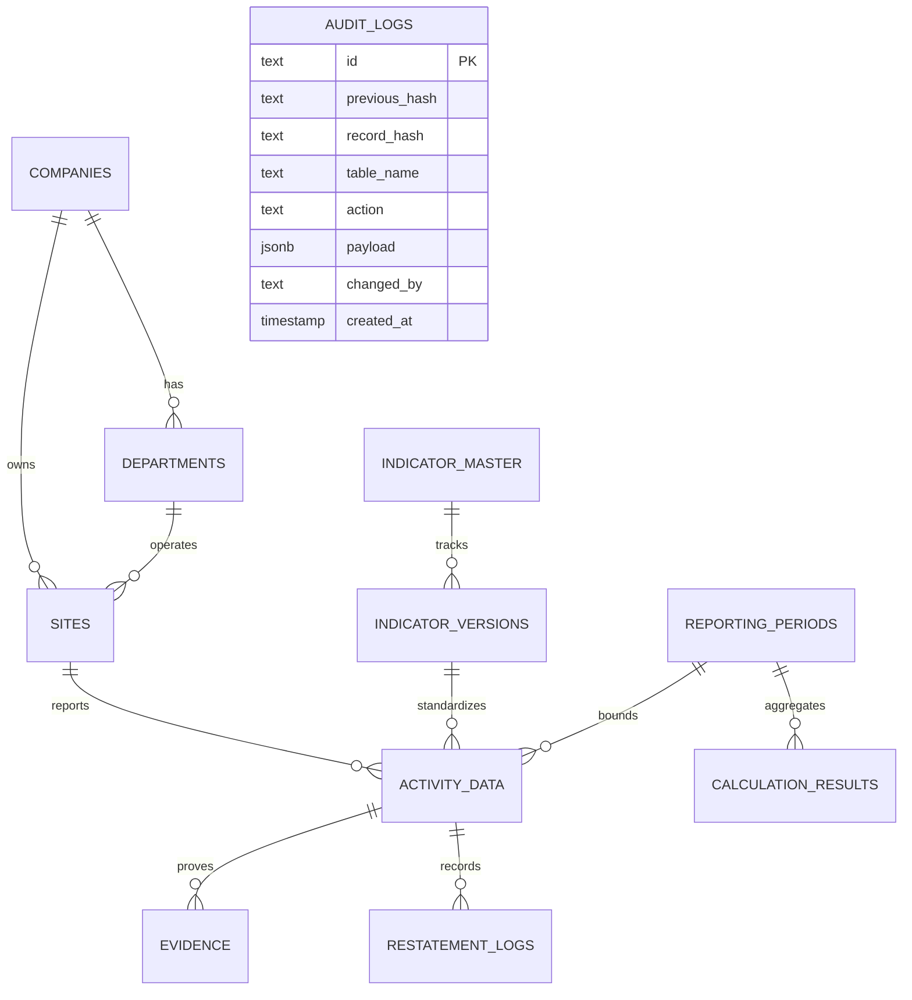

# SustainX Implementation Plan: Monorepo, Drizzle ORM & SEBI BRSR Engine

> **Project:** Megha Engineering & Infrastructures Limited (MEIL) — ESG & BRSR Reporting Portal  
> **Architecture:** Turborepo + `pnpm` Monorepo  
> **Database:** PostgreSQL 17.9 (`sustainx_db`)  
> **ORM:** Drizzle ORM (`drizzle-orm` + `drizzle-kit`)  
> **Calculation Engine:** `decimal.js` (No floating-point drift)  
> **Target Frameworks:** React 18 / Vite (`apps/web`), Fastify / Express (`apps/api`)  
> **Last Updated:** October 11, 2026 (Tightened Architecture & Statutory Audit Revisions)

---

## 🎯 Architecture Review & Hardening Decisions

Following the review of the initial Scope 2 vertical slice, the following architectural decisions and risk mitigations are incorporated into the plan:

### 1. Concrete Physical Hierarchy: `companies` $\rightarrow$ `departments` $\rightarrow$ `sites`
*Why:* Emissions are physical events tied to geolocated plants, DG sets, and utility meter connection points. A generic tree is insufficient for statutory carbon accounting.
- **`companies`**: Legal entities (e.g. *MEIL Infra Projects Ltd*, *Olectra Greentech Ltd*, *DRILLMEC*) with CIN/UIN, GSTIN, ownership/equity share (for operational vs equity control consolidation under GHG Protocol).
- **`departments`**: Functional units (e.g. *EPC Metro*, *Irrigation Heavy Lift*, *Procurement*, *Corporate Safety*).
- **`sites`**: Physical locations (e.g. *Kaleshwaram Pump House #2*, *250MW Kurnool Solar Park*) with coordinates (lat/long), state, grid region (SR/WR/NR for regional emission grid factors), and operational control %.

### 2. Versioned Indicator Master Table (`indicators` & `indicator_versions`)
*Why:* Assurers require statutory traceability of which SEBI circular and framework version an indicator was filed under. Code-only definitions in `.ts` files fail audits.
- **`indicator_master`**: Core indicator metadata (`code`, `name`, `principle_number`, `pillar` Environmental/Social/Governance, `datatype` quantitative vs narrative).
- **`indicator_versions`**: Versioned definitions (`framework_version` e.g. "SEBI_BRSR_2024_CORE", `effective_from`, `unit`, `formula`, `mandatory_evidence_types`).

### 3. Narrative Disclosures Storage (Sections A & B)
*Why:* Sections A (General Disclosures) and B (Management & Process) are textual/qualitative.
- **`narrative_disclosures`**: `company_id`, `indicator_id`, `reporting_period_id`, `text_content`, `structured_json`, `status`, `approved_by`.

### 4. True Cryptographic Tamper-Evidence (SHA-256 Hash Chain)
*Why:* "Append-only" prevents deletions, but "tamper-evident" requires mathematical verification.
- Each `audit_logs` entry stores `previous_hash` and `record_hash` computed over `(previous_hash + table_name + record_id + action + payload + timestamp)`.
- If any row is altered or injected, the chain breaks and verification fails.

### 5. Least-Privilege Role & Database Bypass Protection
*Why:* A superuser can run `ALTER TABLE ... DISABLE TRIGGER`.
- The web API will connect under a dedicated non-owner role (`brsr_app`) with only `SELECT`, `INSERT`, `UPDATE` grants.
- `brsr_app` has no DDL permissions (`NO ALTER, NO DROP`).
- Direct `psql` fallback: trigger records `COALESCE(current_setting('app.user_email', true), session_user, current_user)`.

### 6. Controlled Reopen & Restatement Flow
*Why:* Real-world audits discover supplier billing errors or meter recalibrations. Total locks lead engineers to bypass triggers.
- Status transition: `'APPROVED'` $\rightarrow$ `'REOPEN_REQUESTED'` $\rightarrow$ `'RESTATED'`.
- Reopening requires a mandatory justification reason, original approver approval, revision counter increment, and emits a high-priority audit log.

### 7. Zero-Turnover Calculation Safeguard
- Turnover $\le 0$ returns `null` / `'N/A'`, NOT `'0.000000'`, so it cannot be misconstrued as zero carbon intensity.
- Includes **PPP-adjusted turnover** alongside Rupee turnover for statutory BRSR Core filings.

---

## 🗄️ Database Schema Design (`packages/db/src/schema.ts`)

---

## 🚀 Step-by-Step Priority Build Order

### Step 1: Migration for Hierarchy & Versioned Indicator Master (COMPLETED)
- [x] Create `company`, `department`, and `site` tables with CIN, operational control %, and statutory validity dates.
- [x] Create `indicator` master table with SEBI BRSR Core attribute numbers, versioning, and effective dates.
- [x] Backfill legacy `organisations` into `company` and `site` using recursive ancestor resolution.
- [x] Link existing `activity_data` rows with `site_id`, `dept_id`, `indicator_id`, and `dimension`.
- [x] Attach `audit_row()` triggers to `company`, `department`, `site`, and `indicator`.
- [x] Install `check_activity_hierarchy()` database trigger rejecting cross-company department/site mismatches.
- [ ] Create `narrative_disclosures` table for Section A & B qualitative disclosures.
- [ ] Add `ppp_turnover_inr_crores` to `calculation_results`.

### Step 1.1: Fullstack Authentication & Session Security (COMPLETED)
- [x] Connect frontend directly to PostgreSQL `users` table via `apps/api` REST endpoints.
- [x] Remove mock persona switcher cards and topbar dropdown.
- [x] Add present database credentials selector with 5 pre-configured accounts (Amit Verma CSO, Rahul Sharma Site Engg, Priya Nair ESG Lead, Sarah Jenkins Auditor, Kiran Reddy IT Admin).
- [x] Implement show/hide password eye icon toggle across all password fields.
- [x] Implement self-service password reset via 6-digit dummy OTP (with master bypass `123456`) and salted SHA-256 password hash updating.
- [x] Implement authenticated "Change Password" modal in topbar user menu.
- [x] Implement "Terminate Session" option invalidating active session with atomic logging into `audit_logs`.

### Step 2: Row-Level Security (RLS) & Non-Owner Role (IN PROGRESS)
- [ ] Create least-privilege PostgreSQL role `brsr_app` with no DDL privileges.
- [ ] Enable RLS on `activity_data`, `site`, and `calculation_results`.
- [ ] Define policies:
  - Corporate HQ / Auditors see all companies.
  - Subsidiary / Site engineers can only access records matching their `company_id` / `site_id`.

### Step 3: Cryptographic Hash Chaining & Controlled Restatement Flow
- [ ] Update `audit_row()` trigger function to compute chained SHA-256 hashes (`digest(previous_hash || ... , 'sha256')`).
- [ ] Implement `restate_activity_record()` stored procedure:
  - Checks authorization $\rightarrow$ sets status to `'RESTATED'` $\rightarrow$ logs mandatory reason $\rightarrow$ increments version counter.

### Step 4: Expand Attributes (Water, Energy, Waste)
- [ ] Water footprint: $Net\ Consumption = Withdrawal - Discharge$.
- [ ] Energy footprint: Grid + Solar/Wind + Fuels converted via calorific values to GJ, Renewable Share %.
- [ ] Circularity: Waste generated by type, recovered %, and disposed %.

### Step 5: Document Integrity & AI OCR Integration
- [ ] Compute and verify SHA-256 file checksum on upload before processing.
- [ ] Extract bill fields via OCR with confidence score.
- [ ] Require human verification before saving as draft (never auto-finalize).

---

## 🔍 Verification & Acceptance Criteria
1. **Physical Site Traceability**: Every emission figure traces back to a specific physical `site_id` with lat/long and grid region.
2. **Indicator Versioning**: Assurers can verify the exact framework edition and formula for each filed metric.
3. **Cryptographic Tamper-Evidence**: Modifying any past audit row invalidates the SHA-256 hash chain verification.
4. **Controlled Restatements**: Modifying an approved record succeeds only through the authorized restatement flow with an audit justification.
5. **Zero Turnover Safeguard**: Zero or unentered turnover displays `"N/A"`, preventing false zero-intensity claims.
