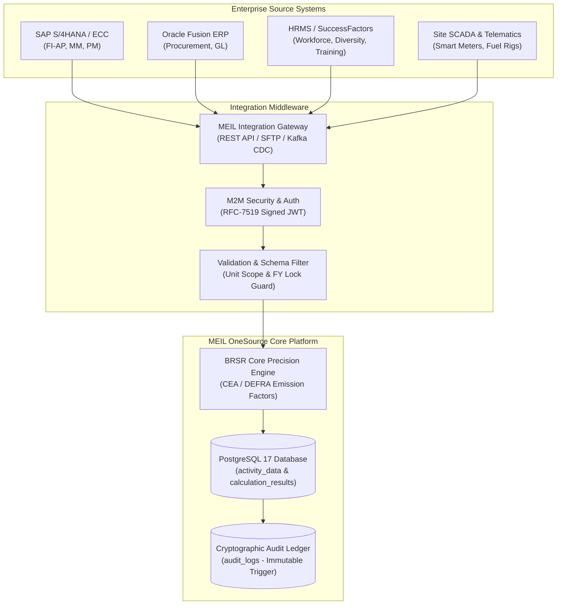

# MEIL OneSource — Enterprise Systems & ERP Integration Guide

> **Document:** Enterprise Integration Architecture & Specifications  
> **Platform:** MEIL OneSource (Central Source for ESG and BRSR Reporting Ease)  
> **Target Systems:** SAP S/4HANA, SAP ECC, Oracle Fusion Cloud, Microsoft Dynamics 365, SCADA/IoT, Workday, SuccessFactors  
> **Standard:** SEBI BRSR Core Protocol & Reasonable Assurance Framework  

---

## 1. System Integration Architecture

MEIL OneSource functions as the centralized statutory ESG repository for Megha Engineering & Infrastructures Limited (MEIL). It consolidates primary operational data across **3 Operating Subsidiaries, 6 Business Units, and 250+ Project Execution Sites**.



---

## 2. ERP Data Domain Mapping Table

This mapping standardizes how transactional records from SAP, Oracle, and enterprise systems map into SEBI-mandated BRSR Core metrics:

| Business Domain | Source ERP Module / Transaction | ERP Data Source | MEIL OneSource Indicator | Ingestion Frequency |
| :--- | :--- | :--- | :--- | :--- |
| **Grid Electricity** | SAP FI-AP (Vendor Billing) / Oracle AP | Monthly DISCOM utility invoices, kWh readings | `P6-E-ELEC` (Scope 2 Grid) | Monthly |
| **Diesel & HSD Fuel** | SAP MM (Goods Issue - MIGO) / Maximo | Fuel purchase orders, site tanker weighbills | `P6-E-DIESEL` (Scope 1 Stationary) | Bi-Weekly / Monthly |
| **Fleet & Machinery** | SAP PM (Plant Maintenance) / Telematics | Telematics engine hours, mobile generator fuel | `P6-E-FLEET` (Scope 1 Mobile) | Weekly |
| **Solar Generation** | SCADA / Inverter Telemetry | Net export meters, solar captive generation | `P6-E-SOLAR` (Renewable Energy) | Daily / Monthly |
| **Water Consumption** | Water flow meters / Tanker bills | Municipal water bills, borewell flow meters | `P6-E-WATER` (Principle 6 Water) | Monthly |
| **Revenue / Turnover** | SAP FI-GL / Oracle Financials | Audited operational revenue (INR Crores) | `TURNOVER_INR_CRORES` | Quarterly / Annual |
| **Workforce & Safety** | SAP SuccessFactors / Oracle HCM / SAP EHS | Total headcount, gender split, LTIFR, training | `P3-MANPOWER`, `P5-SAFETY` | Quarterly |
| **Supply Chain / MSME** | SAP Ariba / MM Procurement | Purchase order value to micro/small suppliers | `P8-MSME-SOURCING` | Quarterly / Annual |

---

## 3. Supported Ingestion Protocols

MEIL OneSource supports four standard integration patterns:

### Pattern 1: REST API (Real-Time & Micro-Batch) — *Recommended*
* **Best for:** Direct integration via middleware (SAP CPI, MuleSoft, Oracle Integration Cloud, or custom microservices).
* **Protocol:** HTTPS REST with JSON payload.
* **Authentication:** RFC-7519 Signed JWT Bearer token with service-account credentials.
* **Headers:** `Authorization: Bearer <TOKEN>`, `Content-Type: application/json`.

### Pattern 2: Database Staging & CDC (Change Data Capture)
* **Best for:** High-volume automated telemetry from 250+ project sites.
* **Protocol:** Debezium, Apache Kafka, or scheduled database ETL pipeline.
* **Buffer Table:** Dedicated staging table in PostgreSQL (`staging_erp_activity`) with automated trigger-based reconciliation into `activity_data`.

### Pattern 3: Automated SFTP / Batch Export (CSV & Parquet)
* **Best for:** Legacy ERP instances without live API capabilities.
* **Protocol:** SFTP drop into secure bucket (`/incoming/erp/`).
* **Format:** Standardized CSV extract (`MEIL_ESG_ACTIVITY_YYYYMMDD.csv`).
* **Execution:** Nightly ingestion parser with variance anomaly detection (>25% outlier alert).

### Pattern 4: Cryptographic Evidence Document Sync
* **Best for:** Attaching utility bills, diesel slips, and calibration certificates.
* **Protocol:** `multipart/form-data` upload to `/api/v1/upload`.
* **Assurance:** Generates SHA-256 file hashes linked to numerical metric rows for third-party auditor inspection.

---

## 4. API Endpoints & Request Specifications

### 4.1 Authentication (Service Account Login)

Exchange service-account credentials for an authorized JWT access token:

```http
POST /api/v1/auth/login HTTP/1.1
Host: localhost:8000
Content-Type: application/json

{
  "email": "sap.integrator@meil-group.demo",
  "password": "YOUR_SERVICE_ACCOUNT_SECRET"
}
```

**Response:**
```json
{
  "token": "eyJhbGciOiJIUzI1NiIsInR5cCI6IkpXVCJ9...",
  "user": {
    "id": "user-erp-svc",
    "email": "sap.integrator@meil-group.demo",
    "roleId": "SYS_ADMIN",
    "organisationId": "meil-group"
  }
}
```

---

### 4.2 Ingesting Scope 2 Grid Electricity (Live Calculation & Sync)

Posts electricity consumption and triggers real-time CEA conversion, turnover scaling, and audit append:

```http
POST /api/v1/scope2/save HTTP/1.1
Host: localhost:8000
Authorization: Bearer <JWT_TOKEN>
Content-Type: application/json

{
  "orgId": "proj-beta",
  "periodId": "fy-2026-27",
  "quantityKwh": 1850000,
  "factorValue": "0.7160",
  "turnoverCr": 120.00,
  "scope1Val": 450.2500,
  "scope3Val": 210.0000,
  "userEmail": "sap.integrator@meil-group.demo",
  "notes": "SAP FI-AP Ingestion: MSEDCL HT Billing Q2 (Doc #9008210)",
  "metadata": {
    "erpSystem": "SAP_S4HANA",
    "erpDocId": "9008210",
    "meterNumber": "HT-4482-BETA",
    "billingMonth": "2026-09"
  }
}
```

**Success Response (200 OK):**
```json
{
  "success": true,
  "recordId": "act-elec-proj-beta-fy-2026-27",
  "scope2_tco2e": "1324.6000",
  "totalGhg_tco2e": "1984.8500",
  "ghgIntensityPerCrore": "16.540417",
  "calculatedAt": "2026-10-13T08:18:00.000Z"
}
```

---

### 4.3 Ingesting Operational Activity Data (General BRSR Metrics)

Generic endpoint for Scope 1 Diesel, Water, Waste, and Social Metrics:

```http
POST /api/v1/entries HTTP/1.1
Host: localhost:8000
Authorization: Bearer <JWT_TOKEN>
Content-Type: application/json

{
  "organisationId": "proj-alpha",
  "reportingPeriodId": "fy-2026-27",
  "indicatorId": "ind-p6-e1-scope1",
  "quantity": "18450.00",
  "unit": "Litres",
  "enteredBy": "sap.integrator@meil-group.demo",
  "notes": "SAP MM Goods Issue: Stationary Diesel Generator Set 04 (Batch #GI-77312)",
  "sourceType": "ERP_AUTOMATED"
}
```

---

### 4.4 Automated Hierarchy Provisioning (Adding Projects & Subsidiaries)

Allows corporate master data systems to automatically register new projects in the MEIL statutory reporting boundary:

```http
POST /api/v1/organisations HTTP/1.1
Host: localhost:8000
Authorization: Bearer <JWT_TOKEN>
Content-Type: application/json

{
  "code": "PRJ-ZOJILA-TUNNEL",
  "name": "Zojila Pass High-Altitude Tunnel Project",
  "type": "PROJECT",
  "parentId": "bu-infra-metro",
  "businessVertical": "Heavy Civil & Underground Transit",
  "country": "India",
  "state": "Jammu & Kashmir",
  "city": "Sonamarg",
  "inBoundary": true,
  "isFilingEntity": false
}
```

---

### 4.5 Utility Evidence PDF Upload (Cryptographic Hashing)

Upload scanned meter cards or utility invoices to satisfy SEBI statutory audit requirements:

```http
POST /api/v1/upload HTTP/1.1
Host: localhost:8000
Authorization: Bearer <JWT_TOKEN>
Content-Type: multipart/form-data; boundary=----WebKitFormBoundary7MA4YWxkTrZu0gW

------WebKitFormBoundary7MA4YWxkTrZu0gW
Content-Disposition: form-data; name="file"; filename="TSSPDCL_Electricity_Bill_Q2.pdf"
Content-Type: application/pdf

[RAW PDF BYTES]
------WebKitFormBoundary7MA4YWxkTrZu0gW--
```

**Response with Cryptographic Hash:**
```json
{
  "success": true,
  "fileName": "TSSPDCL_Electricity_Bill_Q2.pdf",
  "filePath": "/uploads/file-1791859920112.pdf",
  "fileSize": 184920,
  "fileType": "application/pdf",
  "fileHash": "SHA256-a9f4c39120de84b2"
}
```

---

## 5. Code Integration Recipes

### 5.1 Python / Apache Airflow DAG Recipe

```python
import requests
import json

BASE_URL = "http://localhost:8000/api/v1"

def ingest_sap_activity_data():
    # 1. Authenticate with Service Account
    auth_resp = requests.post(f"{BASE_URL}/auth/login", json={
        "email": "sap.integrator@meil-group.demo",
        "password": "YOUR_SERVICE_ACCOUNT_SECRET"
    })
    auth_resp.raise_for_status()
    token = auth_resp.json()["token"]
    headers = {
        "Authorization": f"Bearer {token}",
        "Content-Type": "application/json"
    }

    # 2. Transmit Electricity Meter Batch
    payload = {
        "orgId": "proj-beta",
        "periodId": "fy-2026-27",
        "quantityKwh": 1850000,
        "factorValue": "0.7160",
        "turnoverCr": 120.0,
        "notes": "Automated Airflow Batch Ingest from SAP S/4HANA"
    }
    
    resp = requests.post(f"{BASE_URL}/scope2/save", headers=headers, json=payload)
    resp.raise_for_status()
    print("Ingestion Success:", resp.json())

if __name__ == "__main__":
    ingest_sap_activity_data()
```

---

### 5.2 SAP Cloud Integration (CPI) Groovy Script Recipe

```groovy
import com.sap.gateway.ip.core.customdev.util.Message;
import groovy.json.JsonSlurper;
import groovy.json.JsonOutput;

def Message processData(Message message) {
    def body = message.getBody(String.class);
    def jsonSlurper = new JsonSlurper();
    def sapPayload = jsonSlurper.parseText(body);

    // Transform SAP S/4HANA Billing Doc to MEIL OneSource Schema
    def meilPayload = [
        orgId: sapPayload.CostCenterProjectMap,
        periodId: "fy-2026-27",
        quantityKwh: sapPayload.RecordedKwhQuantity,
        factorValue: "0.7160",
        turnoverCr: sapPayload.ProjectTurnoverCrores,
        notes: "SAP CPI Bridge: Doc Ref " + sapPayload.BillingDocumentNumber
    ];

    message.setBody(JsonOutput.toJson(meilPayload));
    message.setHeader("Content-Type", "application/json");
    return message;
}
```

---

### 5.3 PostgreSQL Automated Staging Pipeline Trigger

```sql
-- Staging Table for Database-to-Database Sync
CREATE OR REPLACE FUNCTION process_erp_staging_record()
RETURNS TRIGGER AS $$
DECLARE
  v_org_id text;
  v_period_id text;
BEGIN
  -- Resolve project code to MEIL internal organisation ID
  SELECT id INTO v_org_id FROM organisations WHERE code = NEW.project_code LIMIT 1;
  SELECT id INTO v_period_id FROM reporting_periods WHERE financial_year = NEW.financial_year LIMIT 1;

  IF v_org_id IS NOT NULL AND v_period_id IS NOT NULL THEN
    -- Upsert activity data with RLS audit trigger
    INSERT INTO activity_data (
      id, organisation_id, reporting_period_id, quantity, unit, entered_by, notes
    ) VALUES (
      'act-erp-' || NEW.erp_doc_id,
      v_org_id,
      v_period_id,
      NEW.quantity,
      NEW.unit,
      'ERP_DATABASE_CDC',
      'Automated Ingest from ' || NEW.erp_system || ' [Doc: ' || NEW.erp_doc_id || ']'
    )
    ON CONFLICT (id) DO UPDATE SET
      quantity = EXCLUDED.quantity,
      updated_at = NOW();

    NEW.sync_status := 'COMPLETED';
  ELSE
    NEW.sync_status := 'FAILED_UNRESOLVED_PROJECT';
  END IF;

  RETURN NEW;
END;
$$ LANGUAGE plpgsql;

CREATE TRIGGER trg_process_erp_staging
BEFORE INSERT ON staging_erp_activity
FOR EACH ROW EXECUTE FUNCTION process_erp_staging_record();
```

---

## 6. Security, Resilience & Compliance

1. **Active FY Lock**: Ingested payloads must match the active financial year (`fy-2026-27`). Submissions for locked or archived periods are rejected with HTTP 400 (`INVALID_FINANCIAL_YEAR`).
2. **Strict Node Scoping**: The API service account cannot write data to projects outside its authorized boundary.
3. **Idempotency**: Requests containing identical ERP Document IDs update existing draft records without duplicating emissions.
4. **Audit Immutability**: Every ingested record triggers PostgreSQL's `audit_row()` trigger, appending the server clock, IP address, and payload diff into `audit_logs`.
5. **Auditor Traceability**: ERP records are tagged with `sourceType: "ERP_AUTOMATED"`, allowing auditors in the **Traceability Explorer** to trace group figures directly back to the ERP document number.
