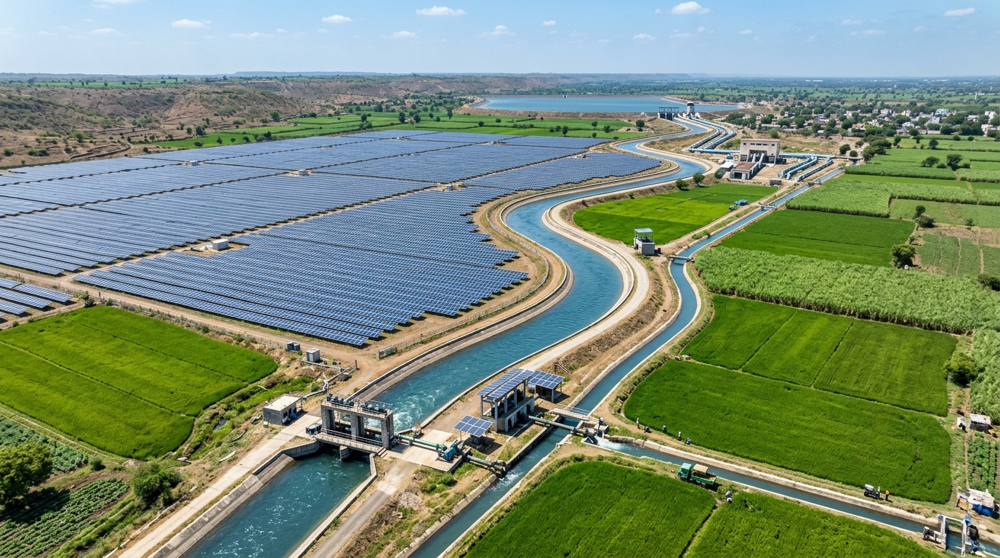
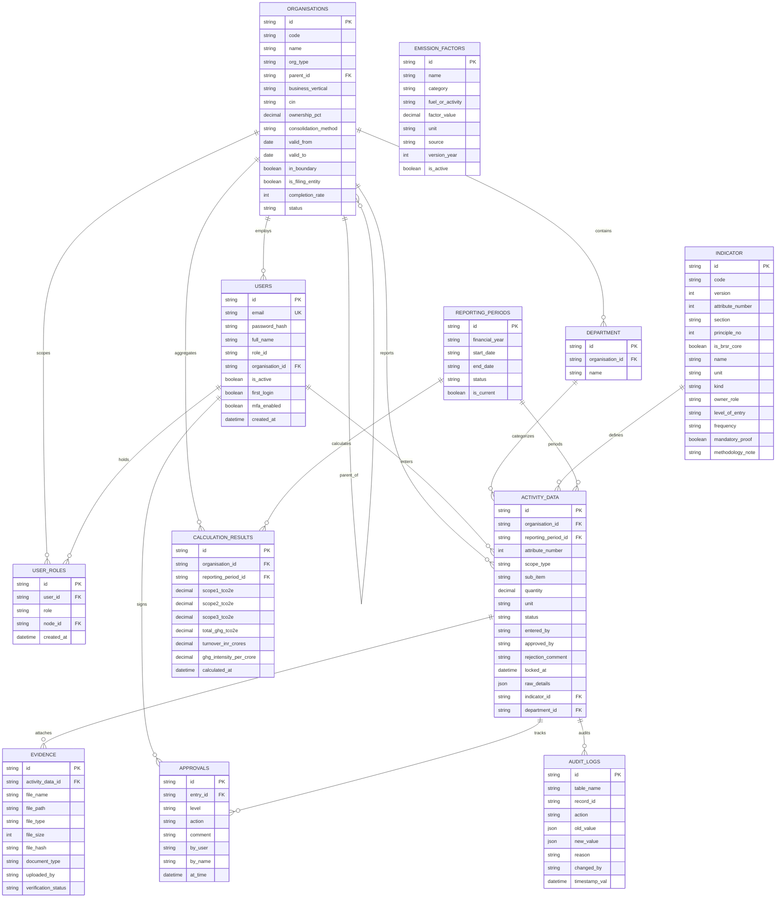
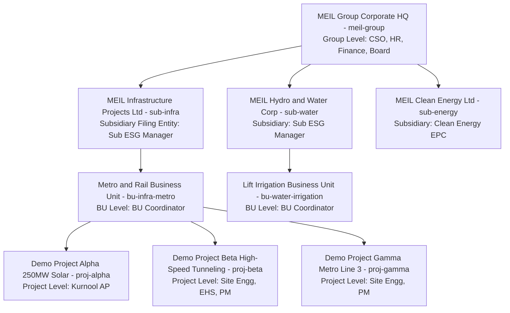
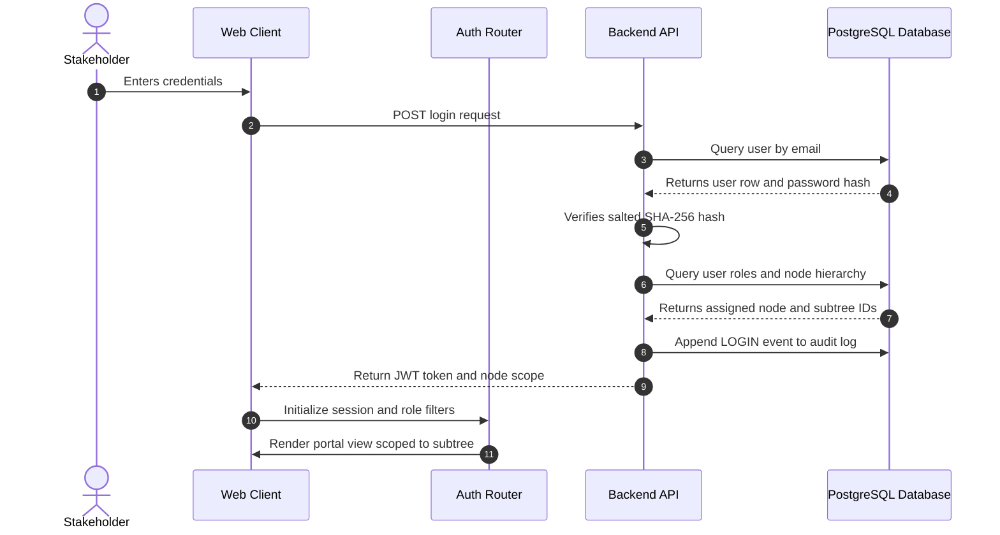
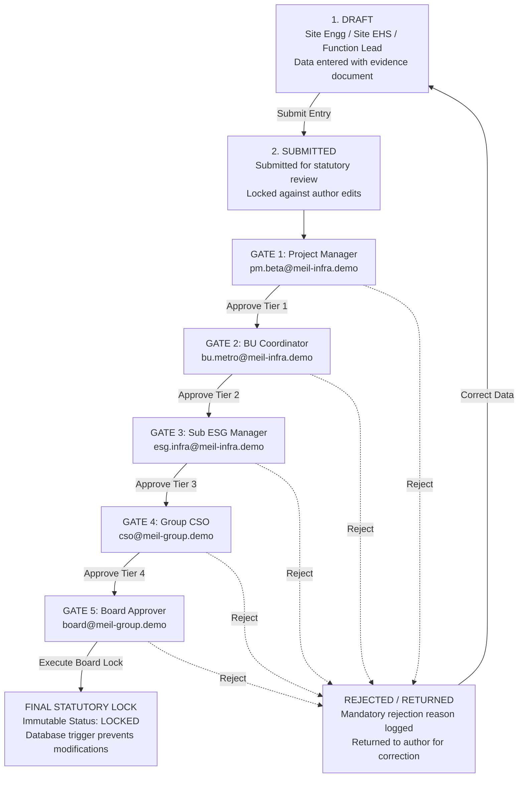
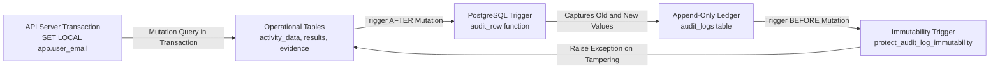

# MEIL OneSource — Central Source for ESG and BRSR Reporting Ease

> **Client Context:** Megha Engineering & Infrastructures Limited (MEIL)  
> **Platform Name:** MEIL OneSource (Central Source for ESG and BRSR Reporting Ease)  
> **Problem Statement:** Unified enterprise portal for SEBI BRSR (Business Responsibility and Sustainability Reporting) and Corporate ESG Reasonable Assurance.  
> **Applicable Standards:** SEBI BRSR Core Circular (`SEBI/HO/CFD/CFD-SEC-2/P/CIR/2023/122`), Revised 2024 SEBI BRSR Framework, and ISAE 3000 Reasonable Assurance Standards.  
> **Architecture:** Turborepo & `pnpm` Monorepo, React 18, Vite, TypeScript, Drizzle ORM, PostgreSQL 17, Fastify/Express REST API, `decimal.js` arbitrary precision math engine.

---

## 📌 Executive Summary

Megha Engineering & Infrastructures Limited (MEIL) is one of India's foremost infrastructure conglomerates with operations spanning 18 Indian states and global footprints across Europe, the Middle East, and South America through subsidiaries including **DRILLMEC S.p.A.**, **Petreven**, and **Olectra Greentech**.

Managing statutory ESG compliance across 250+ active project sites requires replacing fragmented spreadsheets with a **centralized, metadata-driven, validated, and cryptographically traceable data-to-report platform**. **MEIL OneSource** serves as the conglomerate's single source of truth for all sustainability accounting, featuring:

- **5-Level Multi-Tier Organizational Hierarchy** (Group HQ $\rightarrow$ Subsidiary $\rightarrow$ Business Unit $\rightarrow$ Project / Site).
- **Strict Role-Based Access Control (RBAC)** ensuring data entered at the site level automatically aggregates upwards, while users only view and act upon their assigned organizational subtrees.
- **7-Stage / 5-Gate Sequential Review & Approval Governance** (Draft $\rightarrow$ Submitted $\rightarrow$ Project Manager $\rightarrow$ BU Coordinator $\rightarrow$ Subsidiary ESG Manager $\rightarrow$ Group CSO $\rightarrow$ Board Approver Lock).
- **Kernel-Level PostgreSQL Immutability & Auditing** through native PL/pgSQL triggers (`audit_row()`, `protect_audit_log_immutability`) making tampering impossible even via direct database queries.
- **Arbitrary-Precision Mathematical Computation** via `decimal.js` ensuring exact Scope 1, Scope 2, and Scope 3 greenhouse gas calculations and SEBI turnover-intensity ratios without floating-point drift.

---

## 🏗️ Landmark Infrastructure Domains

MEIL OneSource tracks environmental metrics across MEIL's world-record engineering achievements:

| Water Resources & Dam Projects | Heavy Civil, Tunnels & Rail Viaducts | Clean Energy & Solar Canal Grids |
| :---: | :---: | :---: |
|  |  |  |
| **Kaleshwaram Lift Irrigation & Dam**<br/>World's largest multistage lift irrigation system with Asia's largest surge pools. | **Metros, Tunnels & Expressways**<br/>Elevated metro viaducts, mountain tunnels, and high-speed rail engineering. | **2,500+ MW Clean Energy EPC**<br/>Photovoltaic solar parks integrated with agricultural canal irrigation networks. |

---

## 🗄️ Database Structure & Entity-Relationship Model (ERD)

The PostgreSQL 17 database (`sustainx_db`) is designed using Drizzle ORM with strict referential integrity, foreign key cascading, and database-level check constraints.



---

## 🏛️ Conglomerate Hierarchy Architecture

Data flow in MEIL OneSource follows a strictly partitioned tree hierarchy. Operational activity data is recorded at the ground level (Projects / Sites) and cascades upwards through automated consolidation pipelines.



### Hierarchy Rules & Data Boundary Enforcement
1. **Upward Aggregation**: Site logs (diesel, petrol, LPG, grid electricity, water, waste) are entered at the **Project** node. Emission formulas convert these into carbon metrics ($tCO_2e$) and roll up to the parent **Business Unit**, then **Subsidiary**, and finally the **MEIL Group**.
2. **Subtree Partitioning**: A user assigned to a node can only view their own node and descendant nodes:
   - Rahul Sharma at **Demo Project Beta** sees only Project Beta records.
   - Ananya Roy at **Metro & Rail BU** sees Project Alpha, Beta, and Gamma.
   - Priya Nair at **MEIL Infrastructure** sees all BUs and projects under MEIL Infra.
   - Amit Verma (CSO) at **MEIL Group** sees the entire conglomerate tree.
3. **Group Sets Rules**: Emission factors, calculation formulas, and indicator definitions are centrally maintained at Group HQ. Lower-tier nodes consume them as read-only rules.

---

## 🔐 Login Pipeline & Role-Based Scope Resolution

MEIL OneSource implements an enterprise authentication pipeline where every login dynamically resolves the user's statutory role and geographic node boundary.



### Transaction-Scoped Database Row-Level Security
When any data modification occurs, the API server executes within an atomic PostgreSQL transaction:
```sql
SELECT set_config('app.user_email', $1, true);
```
The parameter `true` guarantees that the session context automatically vanishes upon transaction completion. The native `audit_row()` trigger captures `current_setting('app.user_email', true)` directly from the database kernel, preventing user identity spoofing.

---

## 👥 Statutory Demo Accounts Directory

The platform comes pre-seeded with 13 authorized user accounts representing all corporate and operational roles:

| # | Stakeholder Name | Email Address | Statutory Role | Assigned Node & Scope | Access Capabilities |
| :---: | :--- | :--- | :--- | :--- | :--- |
| **1** | **Rahul Sharma** | `rahul@meil-infra.demo` | `SITE_ENGINEER` | Project Beta (High-Speed Tunneling) | Enters Principle 6 (Scope 1 Direct Fuels, Scope 2 Electricity, Water, Waste). |
| **2** | **Vikram Joshi** | `ehs.beta@meil-infra.demo` | `SITE_EHS` | Project Beta (High-Speed Tunneling) | Enters Principle 3 (Safety incidents, LTIFR, fatalities, health training). |
| **3** | **Rajesh Nair** | `pm.beta@meil-infra.demo` | `PROJECT_MANAGER` | Project Beta (High-Speed Tunneling) | **Gate 1 Approver**: Reviews, approves, or rejects Project Beta site data. |
| **4** | **Ananya Roy** | `bu.metro@meil-infra.demo` | `BU_COORDINATOR` | Metro & Rail BU (`bu-infra-metro`) | **Gate 2 Approver**: Consolidates & verifies Projects Alpha, Beta, and Gamma. |
| **5** | **Suresh Rao** | `bu.lift@meil-water.demo` | `BU_COORDINATOR` | Lift Irrigation BU (`bu-water-irrigation`) | **Gate 2 Approver**: Consolidates & verifies irrigation pumping sites. |
| **6** | **Priya Nair** | `esg.infra@meil-infra.demo` | `SUB_ESG_MANAGER` | MEIL Infra Projects (`sub-infra`) | **Gate 3 Approver**: Subsidiary-level oversight, boundary verification. |
| **7** | **Ramesh Patel** | `esg.hydro@meil-water.demo` | `SUB_ESG_MANAGER` | MEIL Hydro & Water (`sub-water`) | **Gate 3 Approver**: Subsidiary-level oversight for water operations. |
| **8** | **Amit Verma** | `cso@meil-group.demo` | `GROUP_ESG_HEAD` | MEIL Group HQ (`meil-group`) | **Gate 4 Approver**: Enters Section B governance, consolidates group ESG report. |
| **9** | **Sunita Rao** | `hr@meil-group.demo` | `GROUP_FUNCTION` | MEIL Group HQ (`meil-group`) | Enters Section A General Disclosures and Principle 5 Human Rights / Diversity. |
| **10** | **Deepak Singhal** | `finance@meil-group.demo` | `GROUP_FUNCTION` | MEIL Group HQ (`meil-group`) | Enters Section A Financials, Principle 1 Governance, Principle 8 CSR, Principle 9. |
| **11** | **Justice (Retd.) K. Murthy** | `board@meil-group.demo` | `BOARD_APPROVER` | MEIL Group Board (`meil-group`) | **Gate 5 Approver**: Final statutory sign-off, executes irrevocable statutory lock. |
| **12** | **Sarah Jenkins** | `auditor@meil-group.demo` | `AUDITOR` | Independent Assurance Scope | Read-only external audit access, evidence verification, trigger audit logs. |
| **13** | **Kiran Reddy** | `admin@meil.demo` | `SYS_ADMIN` | MEIL Enterprise IT (`meil-group`) | User provisioning, role-node bindings, hierarchy maintenance, FY open/close. |

> **Default Demo Credentials:**  
> Password across all demo accounts: `Meil@2026`  
> Quick-fill credential chips are available on the [Login Page](http://localhost:5173/login).

---

## 🚦 7-Stage / 5-Gate Review & Verification Governance Flow

To prevent unauthorized report generation and comply with SEBI BRSR Core Reasonable Assurance standards, every data record progresses through an immutable 5-gate state machine:



### Statutory Gate Capabilities
1. **Gate 1 (Project Manager)**: Checks operational feasibility, invoices, and physical site logs.
2. **Gate 2 (BU Coordinator)**: Cross-checks consistency across all projects under the Business Unit.
3. **Gate 3 (Subsidiary ESG Manager)**: Confirms legal entity boundary compliance and completeness.
4. **Gate 4 (Group CSO)**: Validates group-wide methodology notes, consolidates emissions, checks Section B policies.
5. **Gate 5 (Board Approver)**: Executes statutory lock. Once locked, records are permanently frozen in PostgreSQL.

---

## 📋 Statutory Responsibility Matrix ("Who Fills What")

The table below outlines the division of responsibility across the SEBI BRSR framework:

| BRSR Section / Principle | Description & Scope | Primary Owner Role | Entry Node Level | Frequency & Evidence |
| :--- | :--- | :--- | :--- | :--- |
| **Section A: General Disclosures** | Corporate details, products, plants, operations, employee count, turnover. | `GROUP_FUNCTION` (HR & Finance) | **Group HQ** | Yearly (Audited financial statements) |
| **Section B: Management Disclosures** | ESG policies, Board governance, sustainability targets, stakeholder engagement. | `GROUP_ESG_HEAD` (CSO) | **Group HQ** | Yearly (Policy documents, Board minutes) |
| **Section C: Principle 1** | Ethics, anti-bribery, regulatory penalties, conflict of interest. | `GROUP_FUNCTION` (Legal & CS) | **Group HQ** | Yearly (Legal certifications) |
| **Section C: Principle 2** | Sustainable sourcing, recycled input materials, EPR compliance. | `GROUP_FUNCTION` (Procurement) | **Subsidiary** | Quarterly (Vendor EPR certificates) |
| **Section C: Principle 3** | Employee wellbeing, LTIFR, fatalities, safety committees, health training. | `SITE_EHS` / `GROUP_FUNCTION` (HR) | **Project** / **Group** | Monthly (Safety logs, EHS incident reports) |
| **Section C: Principle 4** | Stakeholder engagement, vulnerable groups, public consultations. | `GROUP_ESG_HEAD` (CSO) | **Group HQ** | Yearly (CSR minutes, consultation reports) |
| **Section C: Principle 5** | Human rights, grievance mechanisms, minimum wages, POSH compliance. | `GROUP_FUNCTION` (HR & Legal) | **Group HQ** | Yearly (POSH committee reports) |
| **Section C: Principle 6 (P6-E1)** | **Scope 1 Direct GHG**: Diesel (DG sets, machinery), Petrol, LPG fuels. | `SITE_ENGINEER` | **Project** | Monthly (Fuel invoices, logbooks) |
| **Section C: Principle 6 (P6-E2)** | **Scope 2 Indirect GHG**: Purchased electricity consumption from grid. | `SITE_ENGINEER` | **Project** | Monthly (Electricity utility bills) |
| **Section C: Principle 6 (P6-E3)** | **Scope 3 Value Chain**: Upstream transport, business travel, waste disposal. | `SITE_ENGINEER` / `GROUP_ESG_HEAD` | **Project** / **Group** | Quarterly (Logistics manifests, travel bills) |
| **Section C: Principle 6 (P6-E4/E5)** | Water withdrawal & consumption, air emissions (NOx, SOx, PM), hazardous waste. | `SITE_ENGINEER` | **Project** | Monthly (Water meter logs, lab test reports) |
| **Section C: Principle 7** | Public policy advocacy, trade association memberships. | `GROUP_FUNCTION` (Legal & Corp Affairs) | **Group HQ** | Yearly (Trade body records) |
| **Section C: Principle 8** | Inclusive growth, CSR projects, local community development. | `GROUP_FUNCTION` (CSR & Finance) | **Group HQ** | Yearly (CSR project ledger, audit reports) |
| **Section C: Principle 9** | Customer satisfaction, complaints, data privacy, product labeling. | `GROUP_FUNCTION` (Legal & Quality) | **Group HQ** | Yearly (Customer satisfaction audits) |

---

## ⚙️ Precision Math & Statutory Calculation Engine

To prevent JavaScript IEEE 754 floating-point inaccuracies, all greenhouse gas calculations are executed using `decimal.js` arbitrary precision arithmetic:

$$\text{Scope 1 Emissions } (tCO_2e) = \frac{(\text{Diesel Liters} \times 2.68) + (\text{Petrol Liters} \times 2.31) + (\text{LPG kg} \times 2.98)}{1000}$$

$$\text{Scope 2 Emissions } (tCO_2e) = \frac{\text{Purchased Grid Electricity } (kWh) \times 0.7160 \text{ (CEA v20 India Factor)}}{1000}$$

$$\text{Total GHG Footprint } (tCO_2e) = \text{Scope 1} + \text{Scope 2} + \text{Scope 3}$$

$$\text{Statutory GHG Intensity} = \frac{\text{Total GHG } (tCO_2e)}{\text{Net Conglomerate Turnover } (₹\text{ Crores})}$$

### Regulatory Factor Registry
- **India Central Electricity Authority (CEA v20)**: $0.7160\text{ kg CO}_2/\text{kWh}$ (official weighted average grid factor for national grid).
- **UK DEFRA / IPCC 2024 Fuels**:
  - Stationary Diesel: $2.68\text{ kg CO}_2e/\text{liter}$
  - Motor Petrol: $2.31\text{ kg CO}_2e/\text{liter}$
  - Commercial LPG: $2.98\text{ kg CO}_2e/\text{kg}$

---

## 🛡️ PostgreSQL Kernel-Level Security & Audit Ledger

Auditing and immutability are enforced directly at the PostgreSQL database engine level via PL/pgSQL triggers:



1. **Universal `audit_row()` Trigger**: Automatically logs every mutation on operational tables, recording table name, action, `OLD` and `NEW` JSONB snapshots, user email, and server clock timestamp.
2. **Append-Only Immutability on `audit_logs`**: Any direct SQL attempt to `UPDATE` or `DELETE` rows from `audit_logs` is intercepted by `protect_audit_log_immutability` and throws a fatal database exception.
3. **Approval Record Lock**: The trigger `prevent_modifying_approved_records` strictly forbids modifying any activity record marked with status `'LOCKED'` or `'GROUP_APPROVED'`.

---

## 🏗️ Monorepo Codebase Structure

```
SustainX/
├── pnpm-workspace.yaml          # Turborepo workspaces (apps/*, packages/*)
├── turbo.json                   # Pipeline build & dev caching configuration
├── package.json                 # Monorepo root scripts
├── docker-compose.yml           # PostgreSQL 17 container definition
├── IMPLEMENTATION_PLAN.md       # Architectural specifications
├── WORK_COMPLETED.md            # Detailed implementation log
│
├── apps/
│   ├── api/                     # Node.js REST API Server (Port 8000)
│   │   ├── src/index.ts         # Fastify/Express endpoints with db.transaction()
│   │   ├── .env.example         # Template configuration
│   │   └── package.json
│   │
│   └── web/ (frontend/)         # React 18 / Vite Web Client (Port 5173)
│       ├── src/pages/           # 13 Enterprise pages (DataEntry, Review, BRSR Core, Audit)
│       ├── src/contexts/        # AuthContext (Multi-role RBAC & device sessions)
│       ├── src/components/      # Enterprise UI components & statutory badges
│       ├── public/              # Official MEIL logos & infrastructure photographs
│       └── package.json
│
└── packages/
    ├── db/                      # Drizzle ORM & Database Layer
    │   ├── src/schema.ts        # 12 Core statutory tables & foreign keys
    │   ├── src/client.ts        # PostgreSQL 17 connection pool
    │   ├── src/triggers.sql     # PL/pgSQL audit_row() and immutability triggers
    │   ├── src/seed.ts          # Seeds CEA/DEFRA factors, MEIL tree & 13 demo accounts
    │   ├── drizzle.config.ts    # Drizzle Kit migration configuration
    │   └── package.json
    │
    └── shared/                  # Contracts & Arbitrary Precision Math Engine
        ├── src/calculator.ts    # Decimal.js calculations (Scope 1/2/3, Intensity)
        ├── src/factors.ts       # CEA India grid & DEFRA fuel factor definitions
        ├── src/attributes.ts    # 9 BRSR Core attributes & 15 Scope 3 category schemas
        └── src/types.ts         # Shared TypeScript interfaces & types
```

---

## ⚡ Quickstart & Setup Guide

### 1. Prerequisites
- **Node.js**: v20.x or v22.x LTS
- **pnpm**: v10.x (`npm install -g pnpm`)
- **PostgreSQL**: 17.x running locally on port `5432`

### 2. Environment Configuration
Create a `.env` file in `backend/` (or copy from `backend/.env.example`):
```env
PORT=8000
DATABASE_URL=postgresql://<db_user>:<db_password>@localhost:5432/sustainx_db
```
*(Replace `<db_user>` and `<db_password>` with your local PostgreSQL credentials).*

### 3. Install Dependencies & Build
```bash
# 1. Install all monorepo dependencies
pnpm install

# 2. Build the shared precision calculation package
pnpm --filter @brsr/shared build

# 3. Apply Drizzle migrations and seed the database with MEIL tree, factors, & demo accounts
pnpm --filter @brsr/db db:seed
```

### 4. Run Development Servers
```bash
# Terminal 1: Run Backend REST API Server (Port 8000)
pnpm --filter @brsr/api dev

# Terminal 2: Run Frontend Web Portal (Port 5173)
cd frontend
npm run dev
```

### 5. Access the Web Application
Open your browser to:
- **Web Portal**: [http://localhost:5173](http://localhost:5173)
- **API Health Check**: [http://localhost:8000/health](http://localhost:8000/health)

---

## 📚 Technical Documentation & Guides

- **[INTEGRATION.md](INTEGRATION.md)**: **Enterprise Systems & ERP Integration Guide** (SAP S/4HANA, Oracle, Dynamics, Kafka CDC, SFTP, M2M JWT API contracts, and code recipes).
- **[ARCHITECTURE_AND_INTEGRATION_GUIDE.md](ARCHITECTURE_AND_INTEGRATION_GUIDE.md)**: Frontend Component Tree, State Management, and Full API Gateway mapping.

---

## 🧪 Evaluator Walkthrough & Verification Steps

To verify the platform's functionality:

1. **Test Role-Based Login & Scope Resolution**:
   - Navigate to [http://localhost:5173/login](http://localhost:5173/login).
   - Use the **Quick-Fill Role Chips** to log in as **Rahul Sharma** (Site Engineer).
   - Notice that the topbar and data entry scope lock to **Demo Project Beta**.
2. **Execute Statutory Data Entry & Real-Time Calculation**:
   - Go to **Data Entry** (`/entry`).
   - Locate indicator **P6-E1-S1** (Scope 1 Direct GHG).
   - Enter fuel values: Diesel = `1000` L, Petrol = `200` L, LPG = `100` kg.
   - Click **"Apply Scope 1 Result & Pre-Fill Methodology Note"** — verify that the precision math formula calculates $3.44\text{ tCO}_2e$ and auto-generates the SEBI methodology note.
   - Upload any proof document and click **"Submit for Review"**.
3. **Test Sequential 5-Gate Review Pipeline**:
   - Log out and log in as **Rajesh Nair** (`pm.beta@meil-infra.demo`, Project Manager).
   - Navigate to **Review & Approval** (`/review`).
   - Verify that the submitted entry appears in Gate 1. Click **"Approve (Gate 1)"**.
   - Repeat sequentially through Gate 2 (**Ananya Roy**), Gate 3 (**Priya Nair**), Gate 4 (**Amit Verma**), and Gate 5 (**Board Approver**).
4. **Verify Kernel-Level Audit Trail**:
   - Navigate to **Audit Trail** (`/audit`).
   - Inspect the immutable audit log displaying the exact server clock timestamp, user identity, action, and JSON state transitions recorded by PostgreSQL.
5. **Inspect Live BRSR Core & Scope 2 Engine**:
   - Navigate to [http://localhost:5173/brsr-core](http://localhost:5173/brsr-core).
   - Test the live electricity calculator linked to the official **CEA India v20 factor ($0.7160\text{ kg CO}_2/\text{kWh}$)**.
   - Expand the **9 BRSR Core Attribute Cards** and inspect the **15 Value Chain Scope 3 Categories**.

---

*Megha Engineering & Infrastructures Limited (MEIL) — MEIL OneSource: Central Source for ESG and BRSR Reporting Ease*
