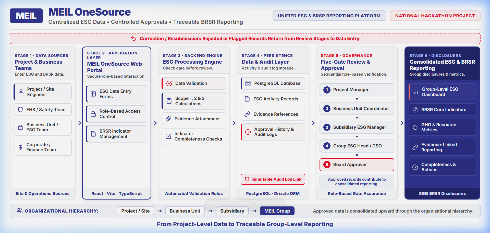

# MEIL OneSource — Hackathon Submission Screenshot Portfolio

> **Central Source for ESG and BRSR Reporting Ease**  
> Complete high-resolution screenshot walkthrough captured at 1536×864 desktop resolution for project evaluation, slide deck presentations, and statutory workflow demonstration.

---

## 🏛️ Master Architecture Infographic

*Clean, professional enterprise architecture infographic designed for national hackathon evaluation: showing the 6-stage end-to-end data pipeline from site sources to SEBI BRSR disclosures, 5-gate review governance, feedback correction loop, database audit hooks, and 4-tier organizational hierarchy.*

---

## 📸 Screenshot Gallery Index

| # | Filename | Module / Page | Key Features Shown |
|---|---|---|---|
| **00** | `meil_onesource_architecture_infographic.png` | **System Architecture Infographic** | Clean 6-stage vector workflow (Sources → Web Portal → Engine → DB & Audit → 5-Gate Review → Reporting) with feedback loop & hierarchy. |
| **01** | `01_corporate_welcome_page.png` | **Corporate Welcome** (`/corporate`) | MEIL mega-infrastructure portal, dynamic KPI tickers (43,000+ MW, ₹32,000+ Cr order book), corporate credentials, ESG commitments. |
| **02** | `02_corporate_landmark_projects.png` | **Landmark Projects** (`/corporate#projects`) | Heavy civil, Polavaram Dam, Zojila Tunnel, Western Solar Park showcase cards with live sustainability metrics. |
| **03** | `03_enterprise_login_page.png` | **Enterprise Authentication** (`/login`) | Dual split-screen enterprise login, official branding, 4-tier role-based quick-access personas (CEO, Auditor, Reviewer, Site Engineer). |
| **04** | `04_executive_esg_dashboard.png` | **Executive ESG Cockpit** (`/dashboard`) | Group-wide decarbonization curves, Scope 1/2/3 breakdown, SEBI filing readiness (87%), intensity metrics, subsidiary comparisons. |
| **05** | `05_site_engineer_operations_dashboard.png` | **Site Operational Dashboard** (`/dashboard`) | Project-scoped operational view for Site Engineers (Polavaram Dam Project), locked FY periods, direct consumption summary cards. |
| **06** | `06_site_data_entry_page.png` | **Site Data Entry** (`/data-entry`) | Operational consumption inputs (Grid electricity, Diesel generators, Water withdrawal), ERP batch sync, statutory invoice attachment. |
| **07** | `07_review_and_approval_governance_center.png` | **Governance & Approval Center** (`/review`) | 4-eye Maker-Checker statutory assurance pipeline, batch verification, anomaly flags, audit approval actions. |
| **08** | `08_brsr_readiness_scorecard.png` | **SEBI BRSR Readiness** (`/brsr-readiness`) | Comprehensive readiness matrix across SEBI Sections A, B, and C (Principles 1–9) with percentage completion counters. |
| **09** | `09_brsr_core_scope2_engine.png` | **BRSR Core Engine** (`/brsr-core`) | Scope 2 electricity emission calculator with CEA CO2 User Guide v20.0 factor sync (0.716 kg CO2/kWh), audit formulas, and verification tags. |
| **10** | `10_traceability_explorer.png` | **Data Traceability** (`/traceability`) | Immutable data lineage tracing statutory disclosures from MEIL Consolidated down to subsidiary, business unit, project site, and meter ID. |
| **11** | `11_statutory_audit_trail.png` | **Statutory Audit Trail** (`/audit-trail`) | Cryptographically logged, chronological revision history with user identity, timestamp, IP, previous value, new value, and audit justification. |
| **12** | `12_reports_and_disclosures.png` | **Reports & Disclosures** (`/reports`) | Export center for official SEBI BRSR Annexure I PDF filings, Big-4 Limited Assurance workbooks, and GRI/GRI-aligned disclosures. |
| **13** | `13_indicators_registry.png` | **Indicators Registry** (`/indicators`) | Central indicator dictionary mapping BRSR Core, GRI, GHG Protocol standards with emission factors and aggregation rules. |
| **14** | `14_organisation_hierarchy_tree.png` | **Organization Structure** (`/organisation`) | Multi-tier self-referencing hierarchy tree: Megha Engineering & Infrastructures Ltd. → Subsidiaries → Business Units → Infrastructure Projects. |
| **15** | `15_statutory_entity_registration_modal.png` | **Entity Registration** (`/organisation` modal) | Modal for registering new statutory subsidiaries, business units, or project sites with CIN, parent linkage, GSTIN, and location tracking. |
| **16** | `16_settings_governance_matrix.png` | **Settings & RBAC Matrix** (`/settings`) | Reporting period governance (FY freeze/unfreeze cycles), ERP sync intervals, and fine-grained role-based permission matrix. |

---

## 🎯 Pitch Deck Recommended Slide Order

1. **Slide 1 — System Architecture Infographic**: `meil_onesource_architecture_infographic.png` (End-to-end 6-stage enterprise workflow & governance)
2. **Slide 2 — Problem & Enterprise Scale**: `01_corporate_welcome_page.png` & `02_corporate_landmark_projects.png`
3. **Slide 3 — Role-Based Enterprise Architecture**: `03_enterprise_login_page.png` & `16_settings_governance_matrix.png`
4. **Slide 4 — Ground-Level Data Capture & ERP Integration**: `06_site_data_entry_page.png` & `05_site_engineer_operations_dashboard.png`
5. **Slide 5 — Statutory Governance & Assurance**: `07_review_and_approval_governance_center.png` & `11_statutory_audit_trail.png`
6. **Slide 6 — SEBI BRSR Core Compliance Engine**: `08_brsr_readiness_scorecard.png` & `09_brsr_core_scope2_engine.png`
7. **Slide 7 — Full Lineage & Multi-Tier Hierarchy**: `10_traceability_explorer.png` & `14_organisation_hierarchy_tree.png`
8. **Slide 8 — Regulatory Filing & Enterprise Expansion**: `12_reports_and_disclosures.png` & `15_statutory_entity_registration_modal.png`
